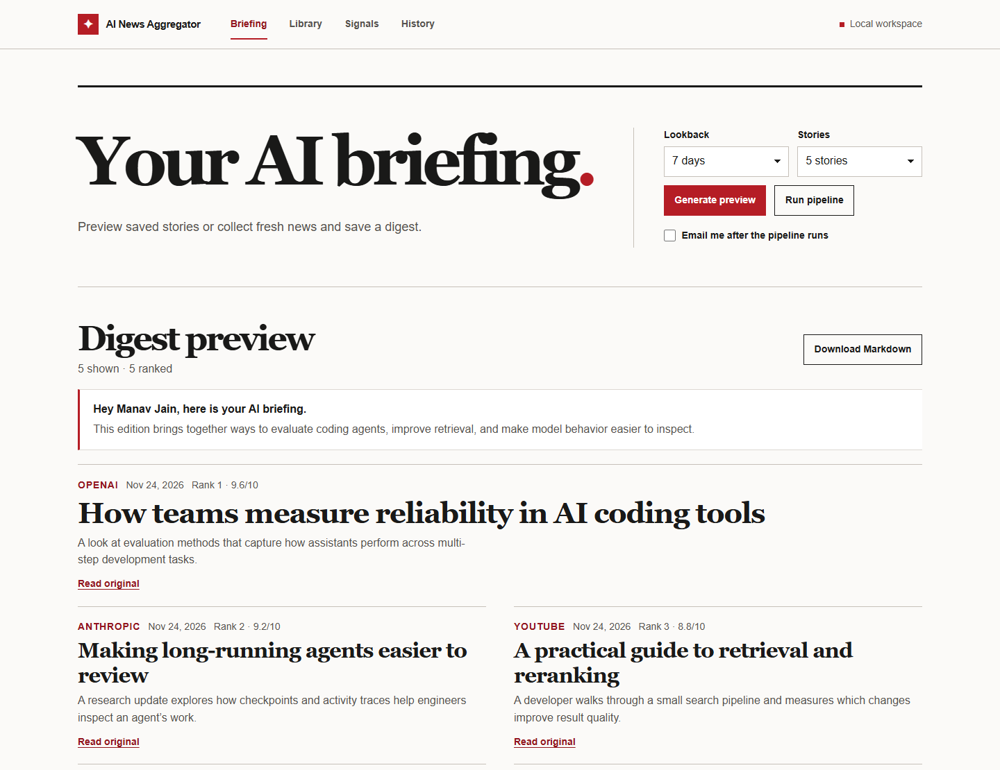
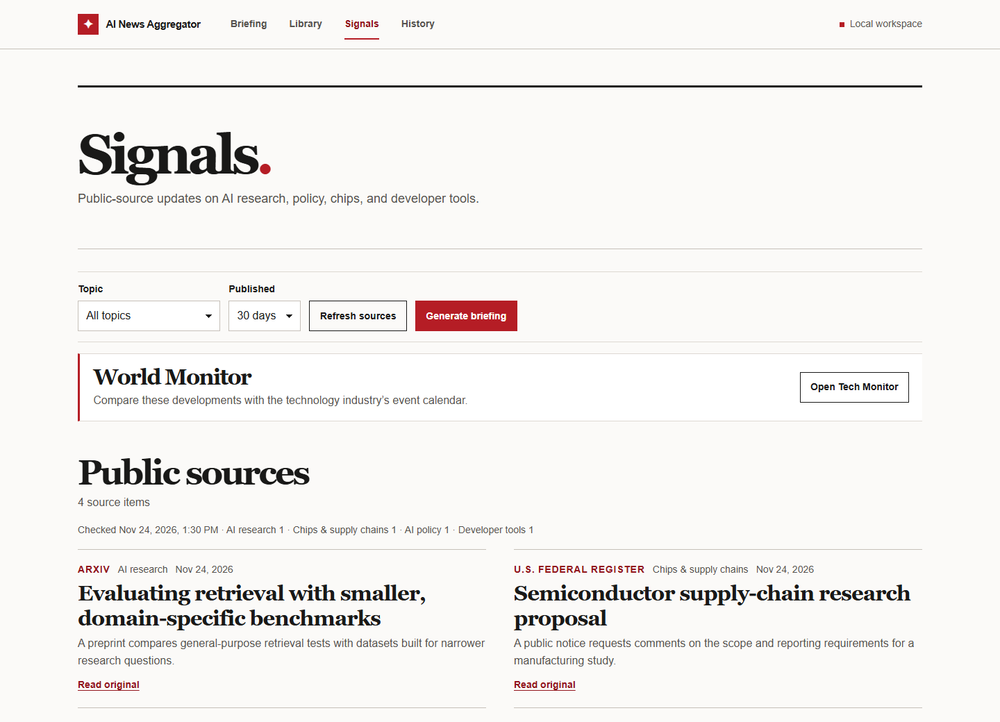

# AI News Aggregator

A local dashboard that turns AI news into ranked briefings. It collects updates from OpenAI, Anthropic, and selected YouTube channels, then uses Gemini to summarize and rank the stories. A separate **Signals** tab follows public updates on AI research, policy, semiconductors, and developer tools.

Built with **Python 3.12**, **PostgreSQL**, **Docker Compose**, and **Gemini**, with a Swiss Editorial interface in HTML, CSS, and JavaScript.



*Dashboard screenshots use sample data.*

## Features

| View | What you can do |
| --- | --- |
| **Briefing** | Choose a lookback and story count, preview a digest from saved summaries, or run the full pipeline. Email delivery is optional in the dashboard. |
| **Library** | Search saved titles and summaries, filter by source and date, and open the original stories. |
| **Signals** | Refresh public feeds, filter by topic and date, and generate a separate briefing with source links. |
| **History** | Reopen saved AI news editions and download them as Markdown. Saved Signals briefings are available inside the Signals tab. |



## Run locally on Windows

Install Docker Desktop and uv. Start Docker Desktop, then open PowerShell in the repository folder.

### 1. Set up Python and PostgreSQL

```powershell
uv python install 3.12
uv sync --locked --no-dev
if (-not (Test-Path .env)) { Copy-Item .\app\example.env .\.env }
docker compose --env-file .env -f .\docker\docker-compose.yml up -d --wait
uv run --no-sync python -m app.database.create_tables
```

### 2. Configure the integrations

Open `.env` in the project root. The [example environment file](app/example.env) contains the local database defaults.

| Environment variable | Purpose |
| --- | --- |
| `GEMINI_API_KEY` | Enables AI summaries and personalized ranking. |
| `MY_EMAIL` and `APP_PASSWORD` | Optional Gmail or Google Workspace address and matching Google App Password for sending digests. |
| `WORLDMONITOR_API_KEY` | Optional key from a World Monitor API plan for loading tech events inside Signals. **Open Tech Monitor** works without a key. |

Keep your actual keys and passwords in your local `.env`, which Git ignores.

### 3. Start the dashboard

```powershell
uv run --no-sync python -m app.dashboard
```

Open [http://127.0.0.1:8765](http://127.0.0.1:8765). On a fresh database, use **Briefing → Run pipeline** to collect and process your first batch. Use **Generate preview** for subsequent editions built from saved summaries.

## How the data flows

1. The pipeline fetches news articles and YouTube updates, then stores new items in PostgreSQL.
2. Gemini summarizes items that still need a summary and ranks recent summaries for the digest. During a temporary ranking outage, the dashboard can save an edition in newest-first order.
3. Saved AI news editions appear in **History**. You can export the Markdown or opt into Gmail delivery when running the pipeline.

**Signals** uses direct feeds from [arXiv](https://info.arxiv.org/help/rss.html), the [U.S. Federal Register](https://www.federalregister.gov/developers/documentation/api/v1), and the [Hugging Face Blog](https://huggingface.co/blog). Click **Refresh sources** to collect updates and **Generate briefing** to save up to five filtered items. [Tech Monitor](https://tech.worldmonitor.app/dashboard) provides additional context, with an optional on-demand calendar through the [World Monitor API](https://www.worldmonitor.app/docs/api-keys).

The default profile and YouTube channels for fresh installs live in [`app/profiles/user_profile.py`](app/profiles/user_profile.py) and [`app/config.py`](app/config.py).

### Run and email a digest from PowerShell

With PostgreSQL running and Gmail configured, this command reviews the last **168 hours** and emails up to **five stories**:

```powershell
uv run --no-sync python main.py 168 5
```

## Credits

Maintained by **Manav Jain**. This project builds on DataLumina’s AI News Aggregator tutorial and adds the Swiss Editorial dashboard, Gemini integration, digest history, and public-source Signals.
